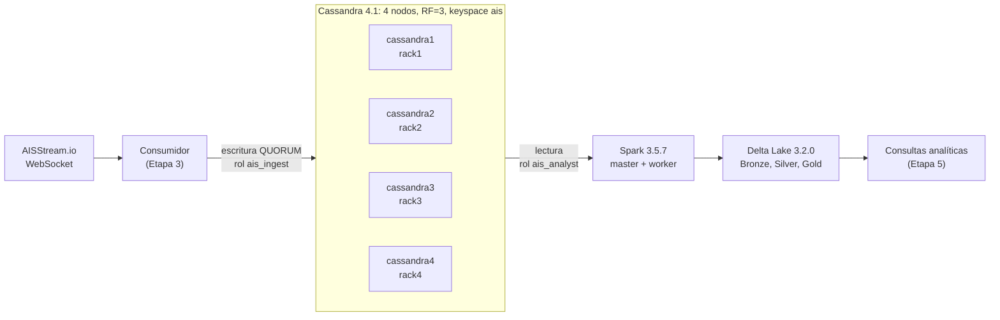

# Proyecto de Procesamiento en Tiempo Real: Maritime AIS Stream

## 1. Enlaces a las APIs y Documentación
* **Sitio oficial / Documentación de API:** [https://aisstream.io](https://aisstream.io)
* **Documentación WebSocket:** [https://aisstream.io/documentation](https://aisstream.io/documentation)
* **APIs del Stream (generación de API key):** [https://aisstream.io/account](https://aisstream.io/account)
* **Endpoint del stream:** `wss://stream.aisstream.io/v0/stream`

## 2. Descripción del Stream de Datos

### Resumen
El stream produce transmisiones en tiempo real de la localización y otros datos de embarcaciones a nivel global mediante el protocolo WebSocket. Incluye alertas e información de identificación de buques (MMSI, nombre, tipo de navío), posición geográfica (latitud, longitud), estado de navegación, velocidad (SOG), rumbo (COG), destino y tiempo estimado de llegada (ETA).

### Origen y Autoría
El stream es operado por la plataforma **AISStream.io**, la cual agrega datos transmitidos por transceptores **AIS (Automatic Identification System)** de barcos, capturados por estaciones base terrestres y receptores satelitales a nivel mundial.

### Diccionario de Datos
En el stream hay 25 tipos de mensaje JSON (los que se pueden pedir con `FilterMessageTypes`), todos estos tienen las etiquetas "MessageType", "MetaData" y "Message". No todos son de eventos maritimos, algunos son respuestas del sistema estos no contienen la información de la embarcación dentro de *MetaData*.

* *MessageType:* Esta nos dice el tipo de mensaje que contiene el JSON.
* *MetaData:* Se encuentra la identidad básica del barco y la posición global.
* *Message:* Son los datos específicos del tipo de mensaje (se eligen de acuerdo con el MessageType).

A continuación se presenta un ejemplo de la estructura del mensaje con MessageType *PositionReport*

```jsonc
{
  "MessageType": "PositionReport", // Tipo de evento 

  "MetaData": // Datos generales de la embarcación
  { 
    "MMSI": 311002056,             // Numérico (Entero): Identificador único de 9 dígitos de la embarcación
    "ShipName": "LEMANIA",    // Texto Libre: Nombre registrado del buque
    "latitude": 38.7398,           // Numérico (Flotante): Latitud en grados decimales (-90 a 90)
    "longitude": 14.81916,         // Numérico (Flotante): Longitud en grados decimales (-180 a 180)
    "time_utc": "2026-10-12 05:14:13.502595905 +0000 UTC" // Serie Temporal: Fecha/hora UTC de recepción del reporte
  },

  "Message": 
  {
    "PositionReport": 
    {
      "Sog": 10.4,                 // Numérico (Flotante): Speed Over Ground / Velocidad en nudos
      "Cog": 272.3,                // Numérico (Flotante): Course Over Ground / Rumbo en grados (0-359.9)
      "TrueHeading": 273,          // Numérico (Entero): Dirección real de proa (511 = No disponible)
      "NavigationalStatus": 0      // Categoría/Cualitativo: Estado (ej. 0 = Bajo motor, 1 = Fondeado)
    }
  }
}
```
> Ejemplo real capturado del stream (abreviado: el mensaje completo trae más campos). Los mensajes completos de `PositionReport` y `ShipStaticData` están en `samples/`.

#### Atributos de los mensajes capturados
La siguiente tabla define cada atributo de los dos tipos de mensaje con los que trabaja el proyecto (`PositionReport` y `ShipStaticData`) y de su `MetaData`. La columna *Clase* indica si es cuantitativa, cualitativa, texto no estructurado, temporal o identificador. Los rangos y frecuencias provienen de la captura de la sección 5. Los valores marcados como "no disponible" son valores centinela del estándar AIS y deben tratarse como nulos.

**`MetaData`** (viene en todos los mensajes de barcos)

| Atributo | Tipo | Clase | Significado | Valores especiales / observaciones |
|---|---|---|---|---|
| `MMSI` | Entero | Identificador | Maritime Mobile Service Identity: código de 9 dígitos que identifica al transmisor AIS. | Se observaron valores 0 (inválidos). |
| `MMSI_String` | Entero | Identificador | Mismo MMSI que el campo anterior. | A pesar del nombre, en la captura llega como número. |
| `ShipName` | Texto | Texto no estructurado | Nombre del barco, máximo 20 caracteres. | Rellenado con espacios al final; vacío en 0.7 % de las posiciones. |
| `latitude` | Decimal | Cuantitativa | Latitud en grados decimales (WGS-84). | Rango observado: -76.9 a 71.6. |
| `longitude` | Decimal | Cuantitativa | Longitud en grados decimales (WGS-84). | Rango observado: -175.2 a 177.4. |
| `time_utc` | Texto (fecha-hora) | Temporal | Momento UTC en que AISStream recibió el mensaje, con precisión de nanosegundos. | Formato `2026-10-12 05:14:13.502595905 +0000 UTC` (no es ISO-8601). |

**`PositionReport`** (Mensajes AIS 1, 2 y 3; 48,366 mensajes en la captura)

| Atributo | Tipo | Clase | Significado | Valores especiales / observaciones |
|---|---|---|---|---|
| `MessageID` | Entero | Cualitativa | Número del mensaje AIS: 1 (programado), 2 (asignado) o 3 (en respuesta a una interrogación). | Observado: 1 (64 %), 3 (35 %), 2 (1 %). |
| `RepeatIndicator` | Entero 0-3 | Cuantitativa (discreta) | Veces que el mensaje fue retransmitido por repetidores. | 3 = no repetir más. |
| `UserID` | Entero | Identificador | MMSI del barco que emite el reporte. | Igual a `MetaData.MMSI`. |
| `Valid` | Booleano | Cualitativa | Indica si el mensaje decodificó correctamente. | Siempre `true` en la captura. |
| `NavigationalStatus` | Entero 0-15 | Cualitativa | Estado de navegación declarado por la tripulación. | 0 = bajo motor, 1 = fondeado, 2 = sin gobierno, 3 = maniobra restringida, 4 = limitado por calado, 5 = amarrado, 6 = varado, 7 = pescando, 8 = navegando a vela, 11 = remolcando a popa, 12 = empujando o remolcando al costado, 14 = baliza AIS-SART activa, 15 = no definido (7.4 % de las posiciones). |
| `RateOfTurn` | Entero | Cuantitativa | Velocidad de giro codificada (0 = sin giro; el signo indica la dirección). | -128 = no disponible (41 % de las posiciones); ±127 = girando a más de 5° cada 30 s. |
| `Sog` | Decimal | Cuantitativa | Speed Over Ground: velocidad sobre el fondo, en nudos, con resolución de 0.1. | 102.3 = no disponible (0.3 %). |
| `PositionAccuracy` | Booleano | Cualitativa | Precisión de la posición: `true` = alta (menos de 10 m), `false` = baja. | `true` en el 60 % de los reportes. |
| `Longitude` | Decimal | Cuantitativa | Longitud en grados decimales. | 181 = no disponible. |
| `Latitude` | Decimal | Cuantitativa | Latitud en grados decimales. | 91 = no disponible. |
| `Cog` | Decimal | Cuantitativa | Course Over Ground: rumbo sobre el fondo, en grados (0 a 359.9). | 360 = no disponible (20 %). |
| `TrueHeading` | Entero | Cuantitativa | Dirección real de la proa, en grados (0 a 359). | 511 = no disponible (43 %). |
| `Timestamp` | Entero 0-63 | Temporal | Segundo UTC del minuto en que el barco generó la posición (no es una fecha completa). | 60 = no disponible (4.3 %); 61 = ingreso manual; 62 = estimada (dead reckoning); 63 = sistema de posicionamiento inoperativo. |
| `SpecialManoeuvreIndicator` | Entero | Cualitativa | Indica si el barco realiza una maniobra especial. | 0 = no disponible, 1 = no realiza maniobra, 2 = realiza maniobra; 3 = reservado (se observó 48 veces). |
| `Spare` | Entero | Sin significado | Bits de relleno del protocolo. | Se ignora. |
| `Raim` | Booleano | Cualitativa | Receiver Autonomous Integrity Monitoring: `true` si el receptor GPS verifica la integridad de su posición. | |
| `CommunicationState` | Entero | Cuantitativa (técnica) | Estado de sincronización y de franjas de tiempo de la radio (SOTDMA/ITDMA). | Útil solo para análisis de la red de radio. |

**`ShipStaticData`** (Mensaje AIS 5; 8,746 mensajes en la captura)

| Atributo | Tipo | Clase | Significado | Valores especiales / observaciones |
|---|---|---|---|---|
| `MessageID` | Entero | Cualitativa | Número del mensaje AIS. | Siempre 5. |
| `RepeatIndicator` | Entero 0-3 | Cuantitativa (discreta) | Veces que el mensaje fue retransmitido por repetidores. | |
| `UserID` | Entero | Identificador | MMSI del barco. | Igual a `MetaData.MMSI`. |
| `Valid` | Booleano | Cualitativa | Indica si el mensaje decodificó correctamente. | Siempre `true` en la captura. |
| `AisVersion` | Entero 0-3 | Cualitativa | Versión del estándar ITU-R M.1371 que cumple el equipo AIS del barco. | Observado: 0, 1 y 2. |
| `ImoNumber` | Entero | Identificador | Número IMO del barco (7 dígitos), único y permanente del casco. | 0 = no disponible (47.6 %). |
| `CallSign` | Texto | Texto no estructurado | Indicativo de llamada de radio (hasta 7 caracteres). | Vacío en 2.1 %. |
| `Name` | Texto | Texto no estructurado | Nombre del barco (hasta 20 caracteres). | Vacío en 0.1 %. |
| `Type` | Entero 0-255 | Cualitativa | Código de tipo de barco y carga (8 bits). | 0 = no disponible; 100-255 = reservados o regionales (se observaron valores mayores a 127); 30 = pesca; 31-32 = remolque; 35 = militar; 36 = vela; 37 = recreo; 50 = piloto; 51 = búsqueda y rescate; 52 = remolcador; 60-69 = pasajeros; 70-79 = carga; 80-89 = tanque; 90-99 = otros. Más frecuentes: 70, 52, 79, 37, 80. |
| `Dimension` | Objeto `A`, `B`, `C`, `D` | Cuantitativa | Dimensiones en metros, medidas desde la antena GPS: `A` hacia la proa, `B` hacia la popa, `C` hacia babor, `D` hacia estribor. Eslora = A + B; manga = C + D. | 0 = no disponible (las cuatro en cero: 2.4 %). Máximos observados: A 511, B 333, C 63, D 63. |
| `MaximumStaticDraught` | Decimal | Cuantitativa | Calado máximo del barco en metros, con resolución de 0.1. | 0 = no disponible (18 %); máximo observado 25.5. |
| `Destination` | Texto | Texto no estructurado | Destino declarado por la tripulación (hasta 20 caracteres). | Vacío en 14 %; abreviaturas y errores frecuentes. |
| `Eta` | Objeto `Month`, `Day`, `Hour`, `Minute` | Temporal | Llegada estimada al destino, declarada por la tripulación. No incluye año. | No disponible: mes 0, día 0, hora 24, minuto 60; también se observa `0/0/0/0`. Juntos suman 26 % de los registros. |
| `FixType` | Entero 0-15 | Cualitativa | Tipo de dispositivo de posicionamiento: 1 = GPS, 2 = GLONASS, 3 = GPS/GLONASS combinado, 6 = sistema de navegación integrado, 7 = topografía (surveyed), 8 = Galileo. | 0 y 15 = no definido (alrededor del 38 %). |
| `Dte` | Booleano | Cualitativa | Bit DTE (Data Terminal Equipment) del estándar: `false` = terminal de datos disponible, `true` = no disponible. | `true` en 2.7 %. |
| `Spare` | Booleano | Sin significado | Bit de relleno del protocolo. | Se ignora. |

### Catálogo de Tipos de Mensajes de AIS Stream
Se enlistan los tipos de mensajes y una descripción, se tomó en cuenta la división que presenta el stream para hacer la lista. Los 4 modelos de *Envelope* describen el protocolo y no cuentan entre los 25 tipos de mensaje filtrables.

#### Envelope (Control y Suscripción)
Mensajes orientados a la gestión del protocolo de conexión WebSocket y notificaciones administrativas del sistema.

* **`AisStreamMessage`**: Objeto contenedor principal (*wrapper*) que encapsula cualquier evento proveniente del stream de datos.
* **`SubscriptionMessage`**: Mensaje de configuración enviado por el cliente para suscribirse a filtros específicos (áreas geográficas o MMSIs).
* **`SubscriptionConfirmation`**: Notificación del servidor que confirma la activación de la suscripción y valida si la compresión (`CompressionEnabled`) está activa.
* **`SubscriptionConfirmationMessage`**: Contenedor envolvente enviado por la API tras procesar una solicitud de suscripción.

#### Position (Telemetría de Posición)
Mensajes de geolocalización e indicadores dinámicos de movimiento de embarcaciones y estaciones terrestres.

* **`PositionReport`**: Reportes dinámicos principales de la nave (Mensajes AIS 1, 2 y 3). Transmite latitud, longitud, velocidad sobre el fondo (`Sog`), rumbo (`Cog`), proa (`TrueHeading`) y estado operacional (`NavigationalStatus`).
* **`BaseStationReport`**: Reporte transmitido por estaciones base en tierra (Mensaje AIS 4). Indica la posición geográfica exacta del receptor terrestre y la marca de tiempo sincrónica.
* **`StandardClassBPositionReport`**: Reporte simplificado de posición emitido por embarcaciones más pequeñas o de recreo que utilizan equipamiento AIS Clase B (Mensaje AIS 18).
* **`ExtendedClassBPositionReport`**: Reporte extendido para Clase B que añade características adicionales del barco a los datos de posición (Mensaje AIS 19).
* **`StandardSearchAndRescueAircraftReport`**: Reporte de posición emitido por aeronaves dedicadas a misiones de Búsqueda y Rescate (SAR / Mensaje AIS 9).
* **`LongRangeAisBroadcastMessage`**: Datos de posición y estado optimizados para ser capturados por satélites u otros sistemas de largo alcance (Mensaje AIS 27).

#### Static and Voyage (Datos del Buque y Travesía)
Información administrativa, física y logística sobre la embarcación y su ruta comercial.

* **`ShipStaticData`**: Datos estáticos y de travesía del buque (Mensaje AIS 5). Contiene el nombre del barco (`Name`), número IMO, tipo de nave (`Type`), dimensiones físicas (`Dimension`), puerto de destino (`Destination`) y tiempo estimado de llegada (`Eta`).
* **`StaticDataReport`**: Reporte en dos partes que transmite los metadatos estáticos de embarcaciones con transceptores Clase B (Mensaje AIS 24).

#### Binary Data (Cargas Útiles de Datos Binarios)
Mensajes orientados a la transmisión de datos personalizados o estructurados entre estaciones.

* **`AddressedBinaryMessage`**: Transmisión de datos binarios dirigida a una embarcación o estación específica por su MMSI (Mensaje AIS 6).
* **`BinaryAcknowledge`**: Acuse de recibo de la recepción exitosa de un mensaje binario previo direccionado (Mensaje AIS 7).
* **`BinaryBroadcastMessage`**: Emisión generalizada de datos binarios difundida a todas las estaciones en rango (Mensaje AIS 8).
* **`SingleSlotBinaryMessage`**: Mensaje binario compacto de longitud reducida enviado en un solo segmento de tiempo (Mensaje AIS 25).
* **`MultiSlotBinaryMessage`**: Mensaje binario extenso enviado a través de múltiples segmentos de tiempo consecutivos (Mensaje AIS 26).
* **`GnssBroadcastBinaryMessage`**: Difusión de correcciones diferenciales GNSS desde una estación base para mejorar la precisión de las posiciones (Mensaje AIS 17).

#### Network and Control (Gestión de Red y Canales)
Comandos del sistema para la gestión del espectro radioeléctrico y asignación de frecuencias.

* **`Interrogation`**: Solicitud enviada por una estación base o barco para requerir datos específicos a otra nave (Mensaje AIS 15).
* **`ChannelManagement`**: Instrucciones para cambiar de canal de transmisión de radiofrecuencia VHF dentro de una zona geográfica definida (Mensaje AIS 22).
* **`DataLinkManagementMessage`**: Datos técnicos de asignación e intercalado de franjas horarias de radio (Slots TDMA / Mensaje AIS 20) para el mantenimiento del enlace de datos marítimo.
* **`GroupAssignmentCommand`**: Instrucciones enviadas a un grupo de barcos para definir sus intervalos de transmisión o frecuencias (Mensaje AIS 23).
* **`DataLinkManagementMessageData`**: Sub-estructura de datos del `DataLinkManagementMessage` (bloques de franjas reservadas).
* **`AssignedModeCommand`**: Comando de una estación base que asigna a una nave su franja de transmisión (Mensaje AIS 16).
* **`CoordinatedUTCInquiry`**: Consulta de fecha y hora UTC dirigida a otra estación (Mensaje AIS 10).
* **`UnknownMessage`**: Mensaje AIS que el stream no pudo clasificar en ninguno de los demás tipos.

#### Safety (Seguridad y Alertas)
Alertas críticas, acuses de recibo y comunicaciones de emergencia marítima.

* **`AddressedSafetyMessage`**: Notificación de seguridad dirigida específicamente a un receptor en particular (Mensaje AIS 12).
* **`SafetyBroadcastMessage`**: Alerta o aviso de seguridad marítima emitido en abierto a todos los barcos en la zona (Mensaje AIS 14).
* **`AidsToNavigationReport`**: Información enviada por balizas, faros o boyas de señalización (AtoN / Mensaje AIS 21), indicando su ubicación y estado.


### Clasificación de Variables
Se presentan algunas de las variables que podemos encontrar dentro de los *Message* y *MetaData*. La clasificación completa de los atributos de `PositionReport`, `ShipStaticData` y `MetaData` está en la columna *Clase* de las tablas del diccionario.

* **Variables Cuantitativas:**
  * `latitude`, `longitude` (Coordenadas geográficas).
  * `Sog` (Velocidad en nudos).
  * `Cog`, `TrueHeading` (Ángulos de dirección/rumbo).
  * `Dimension.A`, `Dimension.B`, `Dimension.C`, `Dimension.D` (Dimensiones físicas de la nave en metros).
  * `MaximumStaticDraught` (Calado máximo del barco, en *ShipStaticData*).

* **Variables Cualitativas:**
  * `MessageType` (Tipo de evento).
  * `NavigationalStatus` (Estado de navegación).
  * `Type` (Categoría de buque, código numérico en *ShipStaticData*).

* **Texto No Estructurado:**
  * `ShipName` (en *MetaData*) / `Name` (en *ShipStaticData*): nombre comercial o registrado.
  * `Destination` (Destino en texto abierto ingresado por la tripulación; suele contener tipografía errónea o abreviaturas no estandarizadas).
  * `CallSign` (Indicativo de llamada de radio).

* **Series Temporales:**
  * `time_utc` (en *MetaData*: marca de tiempo UTC de recepción del mensaje en el stream).
  * `Timestamp` (en *PositionReport*: solo el segundo UTC del minuto, 0-59, en que el barco generó la posición; **no** es una fecha completa).
  * `Eta` (en *ShipStaticData*: llegada estimada declarada por la tripulación, como mes/día/hora/minuto, sin año).

### Consideraciones Éticas y Privacidad

* **Sensibilidad de la Información:** Aunque los datos AIS son de difusión pública por seguridad marítima mundial (IMO/OMI), el monitoreo continuo de embarcaciones pesqueras o recreativas en tiempo real puede exponer patrones de trabajo o ubicaciones sensibles. También podrían presentan riesgos de seguridad si no se gestionan adecuadamente los controles de acceso a los paneles analíticos

* **Calidad y Sesgo:** El campo `Destination` y otros campos son ingresados manualmente por operadores humanos, lo que introduce errores de tipeo y campos nulos.

* **Cobertura desigual:** el stream depende de la red de receptores; hay zonas con mucha cobertura (costas, puertos) y otras casi sin ella (océano abierto), por lo que la ausencia de datos no implica ausencia de barcos.

* **Datos no confiables por diseño:** el transmisor AIS puede apagarse o configurarse con datos falsos (identidad, posición). Los valores "no disponible" del protocolo (p. ej. `TrueHeading = 511`) deben tratarse como nulos y no como datos reales.

* **Garantías del servicio:** AISStream no ofrece SLA ni reenvío de eventos perdidos; si el consumidor es lento, el servicio descarta mensajes. Esto limita las conclusiones sobre completitud.

## 3. Integrantes

* Lucas Garcia Arredondo
* Tania Dominguez
* Alvaro Zunzunegui

## 4. Cómo correrlo (Etapa 1)

```bash
git clone https://github.com/Equipo8-BDNR/Maritime-events-WebSocket.git
cd Maritime-events-WebSocket
uv sync
cp .env.example .env
```

Después se edita `.env` y se pone la API key propia (`AISSTREAM_API_KEY`). Cada integrante genera la suya en [https://aisstream.io/account](https://aisstream.io/account). El archivo `.env` está en `.gitignore` y la llave nunca se sube al repositorio. AISStream no permite conexiones directas desde el navegador: el consumidor corre del lado servidor.

Notas del servicio (según su documentación):

* La suscripción exige `BoundingBoxes`; `FiltersShipMMSI` y `FilterMessageTypes` son opcionales.
* La suscripción debe enviarse dentro de los 3 segundos posteriores a abrir la conexión.
* Máximo 3 conexiones por cuenta y 3 por IP.
* Se debe habilitar `permessage-deflate`; desde septiembre de 2026 las conexiones sin compresión tienen límite de ancho de banda.

## 5. Muestra capturada (referencia)

Captura de 10 minutos con cobertura global (`BoundingBoxes` de todo el mundo) y solo `PositionReport` y `ShipStaticData`, hecha con `scripts/capture.py` (12-oct-2026). El archivo crudo se guarda en `data/` y no se sube al repositorio.

| Métrica | Valor |
|---|---|
| Mensajes recibidos | 57,113 en 611 s (≈ 93 mensajes/s, estable) |
| `PositionReport` / `ShipStaticData` | 48,366 / 8,746 (≈ 5.5 a 1) |
| Embarcaciones distintas (MMSI) | 18,207 |
| Tamaño del JSON crudo | ≈ 32 MB (≈ 190 MB/hora, ≈ 4.6 GB/día) |

Observaciones de calidad de datos en la muestra:

* `TrueHeading = 511` (no disponible) en el 42.6 % de los `PositionReport`; `Cog = 360` (no disponible) en el 19.9 %.
* `Timestamp ≥ 60` (no disponible) en el 4.3 % de los `PositionReport`.
* `Destination` vacío en el 14.0 % de los `ShipStaticData`.
* `Eta` sin valor real en el 26 % de los `ShipStaticData` (`0/0/24/60`: 16 %, `0/0/0/0`: 10 %); además no incluye año.
* `RateOfTurn = -128` (no disponible) en el 41 % de los `PositionReport`.
* `ImoNumber = 0` en el 47.6 % y `MaximumStaticDraught = 0` en el 18.2 % de los `ShipStaticData`; `UserID`/`MMSI` = 0 aparece en algunos mensajes.
* `ShipName` en *MetaData* viene rellenado con espacios al final (20 caracteres); hay que aplicar `strip`.
* `time_utc` no es ISO-8601 (ejemplo: `2026-10-12 05:14:13.502595905 +0000 UTC`) y tiene precisión de nanosegundos.
* El primer mensaje del stream es un `SubscriptionConfirmation`, no un evento marítimo.

## 6. Etapa 2: Infraestructura y arquitectura

### 6.1 Arquitectura general



| Capa | Tecnología | Versión | Función |
|---|---|---|---|
| Ingesta y estado operativo | Apache Cassandra | 4.1 (4 nodos) | Almacena el estado actual de cada barco y su historial reciente; optimizada para escritura |
| Procesamiento analítico (OLAP) | Apache Spark + Delta Lake (lakehouse) | Spark 3.5.7, Delta 3.2.0, conector Cassandra 3.5.1 | Limpieza, enriquecimiento y agregaciones masivas |
| Orquestación | Docker Compose | | Todo se levanta con los archivos de `infra/` |

Los datos reales de la captura (sección 5) fijan los requisitos: unos **93 mensajes por segundo** (≈ 4.6 GB/día de JSON) y consultas por barco (su última posición y su historial).

### 6.2 Por qué Cassandra para la ingesta

| Criterio | Cassandra | MongoDB con sharding |
|---|---|---|
| Replicación y sharding | Vienen en el diseño: anillo de nodos con particionado por hash y réplicas por keyspace | Se arman aparte: replica sets, servidores de configuración y `mongos` |
| Escritura rápida | Estructura LSM (se escribe en memoria y en un registro secuencial) | Buena, pero con más componentes en la ruta de escritura |
| Contenedores mínimos | 3 a 4 | Alrededor de 10 |
| Teorema CAP | AP con consistencia ajustable por consulta | CP por defecto |
| Patrón de acceso | Consulta por llave (barco), ideal para "último estado" e historial por barco y día | Más flexible en consultas, innecesario aquí |

Para el análisis masivo (agregaciones por zona, tipo de barco, tendencias) Cassandra no es adecuada, porque solo consulta eficientemente por llave de partición. Por eso esa parte se hace en Spark sobre Delta Lake.

### 6.3 Replicación y sharding

* **Sharding:** Cassandra reparte los datos por *partition key* con un anillo de hash. Cada nodo tiene 16 rangos (*vnodes*).
* **Replicación:** el keyspace `ais` usa `NetworkTopologyStrategy` con factor de replicación **3** en el datacenter `dc1`. Cada nodo está en su propio *rack*, de modo que las 3 réplicas de un dato quedan en racks distintos.
* **Por qué 4 nodos:** con 3 nodos y réplica 3, cada nodo guardaba el 100 % de los datos y el sharding no se podía observar. Con 4 nodos cada uno guarda cerca del 75 %.

Evidencia (`nodetool status ais`):

| Nodo | Rack | Porcentaje de datos que guarda |
|---|---|---|
| cassandra1 | rack1 | 74.7 % |
| cassandra2 | rack2 | 74.7 % |
| cassandra3 | rack3 | 77.4 % |
| cassandra4 | rack4 | 73.2 % |

Evidencia (`nodetool getendpoints ais vessel_latest <mmsi>`): cada barco vive en un subconjunto distinto de 3 de los 4 nodos. En 12 barcos de la muestra aparecieron 4 combinaciones distintas:

| MMSI | Nodos que guardan al barco |
|---|---|
| 311002056 | cassandra1, cassandra2, cassandra4 |
| 431002141 | cassandra1, cassandra2, cassandra3 |
| 227975290 | cassandra2, cassandra3, cassandra4 |
| 244050680 | cassandra1, cassandra3, cassandra4 |

### 6.4 Modelo de datos

El diseño parte de las consultas, no de los datos:

| Tabla | Llave primaria | Consulta que resuelve |
|---|---|---|
| `ais.vessel_latest` | `mmsi` | Última posición conocida de un barco (lectura puntual con latencia mínima) |
| `ais.position_by_vessel_day` | `((mmsi, day), event_time DESC, event_nanos DESC)` | Historial de un barco en un día, del más reciente al más antiguo |
| `ais.vessel_static` | `mmsi` | Datos estáticos del barco (nombre, tipo, dimensiones, destino, ETA) |

Decisiones de diseño:

* **Estado actual con escritura idempotente:** `vessel_latest` se escribe con `USING TIMESTAMP` igual a la hora del evento. Si un mensaje llega desordenado, Cassandra conserva el más reciente (*last write wins* por hora del evento) y no el último en llegar.
* **Historial acotado:** `position_by_vessel_day` tiene un TTL de 3 días y compactación `TimeWindowCompactionStrategy` con ventanas de 1 día, la adecuada para series de tiempo que expiran. El historial largo vive en el lakehouse.
* **Valores crudos:** la capa de ingesta guarda los valores tal cual llegan (incluidos los centinela como `TrueHeading = 511`). La limpieza se hace en la capa analítica (Etapa 4), lo que permite mostrar la trazabilidad del dato.
* **Hallazgo: colisión de llaves.** En la primera prueba, 1 de 48,366 posiciones se perdió: dos mensajes distintos del mismo barco llegaron con menos de 1 microsegundo de diferencia y el tipo `timestamp` de Cassandra solo tiene milisegundos, así que el segundo sobrescribió al primero. Se corrigió agregando `event_nanos` (los nanosegundos restantes) a la llave. Tras el cambio se guardan las 48,366.

### 6.5 Control de accesos

* La autenticación está activada desde el arranque (`PasswordAuthenticator` y `CassandraAuthorizer`).
* El usuario por defecto `cassandra/cassandra` se deshabilita; se crea un superusuario propio, `ais_admin`.
* El keyspace `system_auth`, que guarda los usuarios, se replica 3 veces (por defecto era 1; si caía ese nodo nadie podría entrar).
* Las contraseñas se generan al azar con `setup_security.sh` y se guardan solo en `.env`, que está en `.gitignore`.
* Los puertos de Cassandra y de Spark solo escuchan en `127.0.0.1`.

| Rol | Permisos sobre el keyspace `ais` | Uso |
|---|---|---|
| `ais_admin` | Superusuario | Crear esquema y roles |
| `ais_ingest` | `SELECT`, `MODIFY` | Consumidor que escribe el stream |
| `ais_analyst` | `SELECT` | Spark y analistas (solo lectura) |

El script comprueba automáticamente que `ais_ingest` puede escribir, que `ais_analyst` puede leer pero recibe *Unauthorized* al escribir, y que el usuario por defecto ya no puede entrar. Las 4 pruebas pasaron.

### 6.6 Justificación según el teorema CAP

**Prioridad: disponibilidad y tolerancia a particiones (AP), con consistencia ajustable.**

* **Por qué disponibilidad:** AISStream no ofrece SLA ni reenvío de mensajes perdidos, y descarta mensajes si el consumidor es lento. Un mensaje que no se escribe a tiempo se pierde para siempre, así que la base de datos debe aceptar escrituras aun con un nodo caído o una partición de red.
* **Por qué la consistencia inmediata es secundaria:** cada posición reemplaza a la anterior del mismo barco. Si dos réplicas difieren por unos instantes, converge sola (resolución por hora del evento) y el impacto es una posición con segundos de retraso, no un dato incorrecto.
* **Ajuste por operación:** las escrituras y las lecturas puntuales usan `QUORUM`. Con réplica 3, `QUORUM` son 2 réplicas; como escritura (2) más lectura (2) es mayor que 3, una lectura siempre ve la última escritura confirmada. El clúster tolera la caída de **un** nodo sin perder disponibilidad. Si se cayeran más réplicas de un mismo dato, se puede bajar a `LOCAL_ONE` y aceptar consistencia eventual.
* **Qué se sacrifica:** consultas ad hoc y joins, que no son eficientes en Cassandra y se resuelven en Spark.

La capa analítica prioriza **consistencia** de lectura, porque Delta Lake ofrece transacciones ACID sobre los archivos.

### 6.7 Capa analítica

* Spark 3.5.7 en modo clúster (un *master* y un *worker* de 2 núcleos y 1.5 GB), con Delta Lake 3.2.0 y el conector de Cassandra 3.5.1 (compatible con Spark 3.5 y Cassandra 4.x/5.0).
* Spark se conecta con el rol de solo lectura `ais_analyst`: aunque el código analítico tenga un error, no puede modificar la base de ingesta.
* Arquitectura *medallion*: **Bronze** (copia fiel de lo ingestado, ya implementada), **Silver** (limpieza y normalización) y **Gold** (agregaciones para las consultas), estas dos últimas en la Etapa 4.
* Prueba de humo (`spark/jobs/smoke_test.py`): lee las tablas de Cassandra, escribe `position_by_vessel_day` como tabla Delta y la vuelve a leer. Resultado: 17,028 barcos en `vessel_latest` y 48,366 filas en el historial, que coinciden entre Cassandra y Delta.

### 6.8 Rendimiento preliminar de escritura

Con un solo cliente en una laptop y consistencia `QUORUM`, el cargador de prueba (`scripts/load_sample.py`) logró unas **5,000 a 7,000 escrituras por segundo** en las tablas de posiciones, contra las 93 por segundo que genera el stream (margen de unas 50 veces). Es una medición preliminar; la prueba de carga formal, sin pérdida de mensajes y con fallos inyectados, se hará en la Etapa 3.

### 6.9 Cómo levantar la infraestructura

```bash
cp .env.example .env
docker compose -f infra/cassandra/docker-compose.yml up -d
bash infra/cassandra/setup_security.sh
bash infra/cassandra/apply_schema.sh
uv run python scripts/capture.py 600
uv run python scripts/load_sample.py
docker compose --env-file .env -f infra/spark/docker-compose.yml up -d
bash spark/submit.sh smoke_test.py
```

Antes del primer comando, en `.env` hay que poner la llave `AISSTREAM_API_KEY`. El clúster de Cassandra tarda unos minutos porque los nodos arrancan en secuencia. Se necesitan unos 7 GB de memoria asignados a Docker.

### 6.10 Estructura del repositorio

| Ruta | Contenido |
|---|---|
| `infra/cassandra/` | `docker-compose.yml`, `schema.cql`, `setup_security.sh`, `apply_schema.sh` |
| `infra/spark/` | `docker-compose.yml` del clúster Spark |
| `spark/` | `submit.sh` y los jobs en `spark/jobs/` |
| `scripts/` | `capture.py` (captura del stream) y `load_sample.py` (carga de prueba) |
| `samples/` | Mensajes reales de ejemplo |

### 6.11 Pendiente para las siguientes etapas

* Consumidor en vivo que desacople la lectura del WebSocket de la escritura a Cassandra, con prueba de carga y medición de mensajes recibidos contra persistidos (Etapa 3).
* Pruebas de resiliencia: caída de un nodo y recuperación automática (Etapa 3).
* Jobs de limpieza, enriquecimiento con datasets estáticos y transformación a Silver y Gold (Etapa 4).
* Cinco consultas analíticas y análisis de trazabilidad del dato (Etapa 5).
